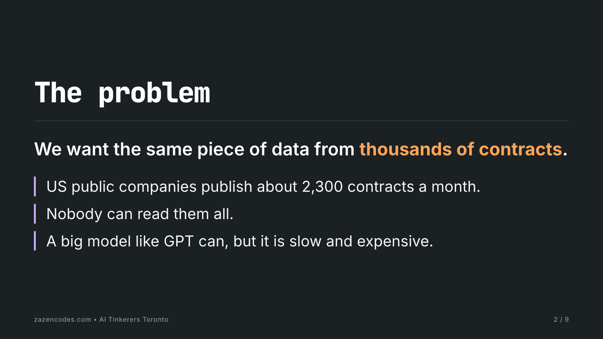
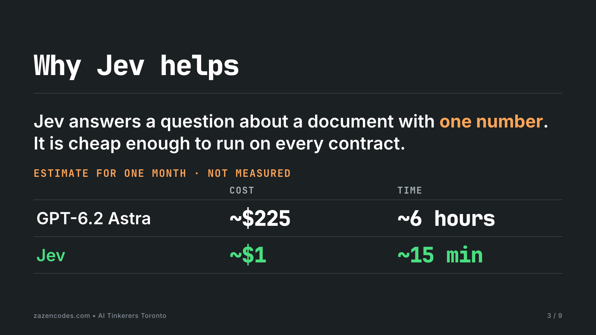
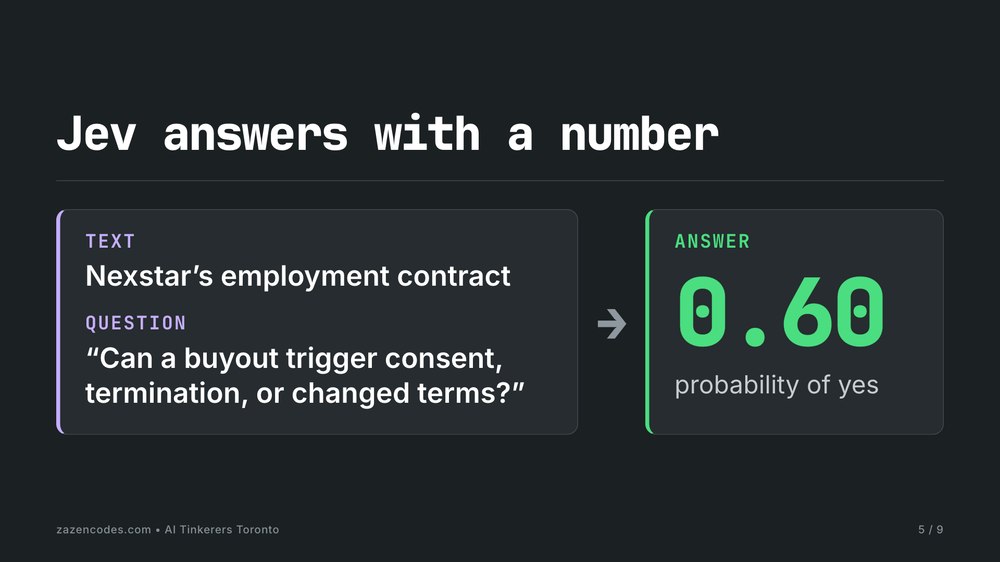
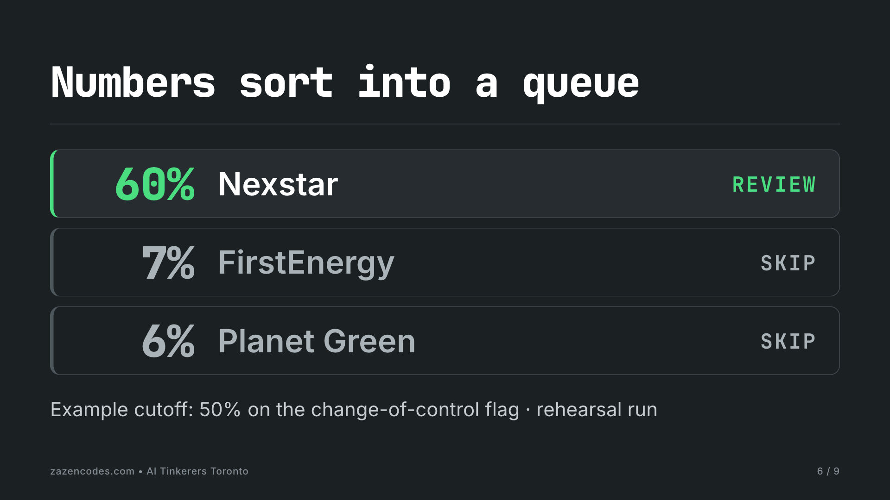
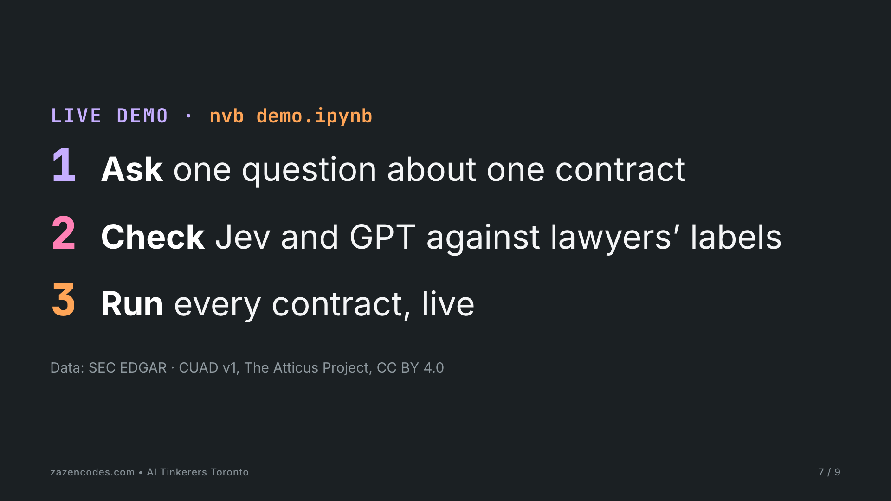
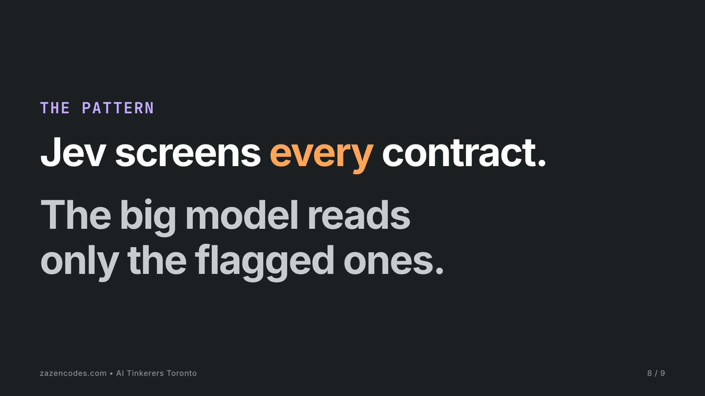

# Jev on the SEC firehose

Extracting data from thousands of contracts with a cheap, fast model.

A six-minute live demo by Alexander Galea at [AI Tinkerers Toronto](https://toronto.aitinkerers.org), November 2026 Meetup: Legal Tech with Clio, on November 26, 2026.

- **Notebook:** [`demo.ipynb`](demo.ipynb), the code run live on stage
- **Slides:** [`slides.pdf`](slides.pdf)
- **Event:** [AI Tinkerers Toronto November 2026 Meetup: Legal Tech with Clio](https://toronto.aitinkerers.org/p/ai-tinkerers-toronto-november-2026-meetup-legal-tech-with-clio)
- **Community:** [AI Tinkerers Toronto](https://toronto.aitinkerers.org)
- **Alexander Galea:** [zazencodes.com](https://zazencodes.com) · [LinkedIn](https://www.linkedin.com/in/alexandergalea/)

## Slides
















## Run the notebook

The notebook puts the same contracts and the same question to Jev and to an OpenAI GPT model. You need a TypeSafe API key and an OpenAI API key, and [uv](https://docs.astral.sh/uv/getting-started/installation/).

```sh
git clone https://github.com/zazencodes/jev-sec-firehose-talk.git
cd jev-sec-firehose-talk
export TYPESAFE_API_KEY=your_typesafe_key OPENAI_API_KEY=your_openai_key
uv run --with jupyterlab --with openai --with typesafe-sdk --with pydantic jupyter lab demo.ipynb
```

`LLM_MODEL` on line 3 of the first cell picks the GPT model. The big run in section 3 stops each model when it reaches `SPEND_LIMIT`.

## What's in this repo

| Path | What it is |
|---|---|
| [`demo.ipynb`](demo.ipynb) | The live demo |
| [`slides.pdf`](slides.pdf) | The slides, also as images in [`assets/slides/`](assets/slides) |
| [`edgar.py`](edgar.py) | Downloads the Exhibit 10 contracts attached to a month of 8-K filings on SEC EDGAR |
| [`data/exhibits/`](data/exhibits) | 750 contracts filed in November 2026, one file per filing day |
| [`data/cuad-sample.json`](data/cuad-sample.json) | Eight CUAD contracts with lawyers' labels for change of control, non-compete and uncapped liability |
| [`prepare_cuad.py`](prepare_cuad.py) | Rebuilds the CUAD sample |

The contracts come from [SEC EDGAR](https://www.sec.gov/edgar/search/). The labeled sample comes from [CUAD v1](https://huggingface.co/datasets/theatticusproject/cuad) by The Atticus Project, licensed CC BY 4.0.
